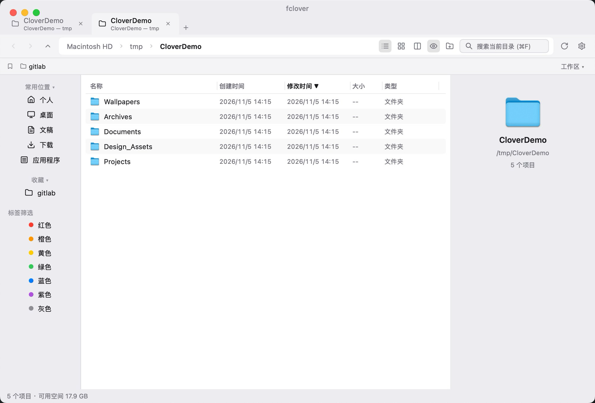
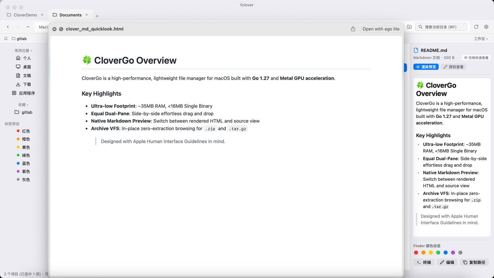

# CloverGo

<p align="center">
  
</p>

<p align="center">
  <strong>看起来是克制优雅的 macOS 原生访达，用起来是行云流水的 Windows Clover 多标签，骨子里是 100% 纯 Go 与 Metal GPU 驱动的极速轻量引擎。</strong>
</p>

<p align="center">
  <a href="https://github.com/bighaidao/clover-go/releases"></a>
  <a href="https://golang.org"></a>
  <a href="https://apple.com/macos"></a>
  <a href="LICENSE"></a>
  <a href="#"></a>
  <a href="#"></a>
</p>

<p align="center">
  
</p>

---

## 🌟 为什么选择 CloverGo？(Why CloverGo?)

长久以来，macOS 上的文件管理体验总在两个极端之间撕裂：
1. **系统原生访达 (Finder)**：优雅克制，但缺乏真正的多标签工作流（无法固定标签、无撤销恢复），没有左右对等双栏，查看压缩包必须先解压，批量重命名与预览能力有限；
2. **第三方商业工具 (QSpace / ForkLift 等)**：功能强大，但闭源收费（￥60~200），功能庞杂臃肿，配置项繁复；
3. **Electron 类新型应用**：现代好看，但常驻内存动辄 300MB~600MB，冷启动缓慢，耗电严重。

**CloverGo** 另辟蹊径——基于 **纯 Go (`CGO_ENABLED=0`) + Metal GPU 原生渲染**，打造出一款**单二进制 <16MB、常驻内存仅 ~35MB、0% 空闲 CPU、120Hz 顺滑响应**、且 **100% 纯本地运行、零隐私数据收集** 的现代化 macOS 文件管理器。

### 📊 核心维度对比矩阵

| 维度 / 特性 | macOS 原生访达 (Finder) | 常见商业文件管理器 | CloverGo (开源免费) |
| :--- | :---: | :---: | :---: |
| **标签页体验** | 基础标签（易误关/无法固定） | 支持，但界面偏重 | **Clover 式页感标签、固定标签 (Pin)、关闭撤销恢复 (`⇧⌘T`)** |
| **窗格布局** | 仅单窗格 / 需开多个窗口 | 双栏 / 四栏 | **左右对等双栏 (Equal Dual-Pane)，跨栏拖拽对齐** |
| **Markdown 预览** | 仅纯文本代码或需插件 | 需安装扩展插件 | **内置富文本可视化渲染 / 源码编辑双模秒级切换** |
| **压缩包浏览** | 必须双击解压到磁盘 | 部分支持 | **就地免解压虚拟穿透浏览 (VFS)，直接读取 `.zip` / `.tar.gz`** |
| **生产力工具** | 基础批量重命名 | 需外挂辅助工具 | **内置积木式批量重命名、PDF 水印与合并/拆分工具箱** |
| **内存与能耗** | ~80MB 常驻 | ~180MB - 450MB | **~35MB 超低常驻，0% 空闲 CPU，瞬时冷启动** |
| **渲染引擎** | Cocoa AppKit | AppKit / Qt / Web | **Metal GPU 硬件加速 (120Hz ProMotion 瞬时响应)** |
| **开源与隐私** | 闭源系统内置 | 闭源商业软件 | **100% 源码开放 (MIT)，纯本地运行，零遥测上报** |

---

## 🚀 核心杀手级特性 (Feature Highlights)

### 1. 灵魂多标签与工作区管理 (Clover-style Tabs & Workspaces)
- **类似浏览器的标签栏**：新建标签 (`⌘T`)、快速关闭 (`⌘W`)、关闭历史栈一键撤回恢复 (`⇧⌘T`)。
- **固定标签 (Pin Tab)**：右键固定高频目录为紧凑图标，免疫 `⌘W` 误关。
- **同名目录智能消歧**：打开两个相同名称的项目目录（如 `src`）时，自动显示父级目录副标题（如 `src — projectA`）。
- **命名工作区 (Workspaces)**：一键保存当前整套标签页与双栏布局，按工作场景秒级复原。

### 2. 随处可拖拽的双栏工作台 (Anywhere DnD & Dual-Pane)
- **左右对等双栏**：单标签内一键切分左右对等独立窗格，当前获得焦点的窗格呈现鲜明 Accent 高亮环。
- **全场景随处拖放 (Anywhere Drag & Drop)**：
  - 跨栏移动 / 按住 `⌥` 快速复制；
  - 拖拽任意文件悬停至子文件夹行直接移入；
  - 拖入顶部面包屑导航的任意上级胶囊直接返回上级归档；
  - 拖入顶部其他标签页直接归类；
  - 拖拽文件夹至左侧边栏即刻固定为收藏书签；
  - 原生支持与外部桌面、原生 Finder、微信、VSCode 双向拖拽。

### 3. 超级常驻预览系统 (Super Preview & Dual-Mode Markdown)
- **Markdown 原生双模预览**：
  - **渲染预览模式**：内置 Metal 原生富文本渲染引擎，排版精美，告别干瘪纯文本代码；
  - **源码查看模式**：基于 Zed 内核代码高亮编辑器，带行号与语法高亮，一键无缝切换。
- **多媒体即时预览**：图片高保真缩略图与 Exif 尺寸、PDF 多页微缩图、GIF 动图与视频画框。
- **原生空格 Quick Look**：选中任意项敲击 `Space` 即刻唤起 macOS 原生系统级快速查看。

<p align="center">
  
</p>

### 4. 压缩包免解压穿透浏览 (In-place Archive VFS)
- 彻底告别“看个压缩包还要先解压出几千个碎片文件”的痛点。
- 双击 `.zip` 或 `.tar.gz` 即可像普通文件夹一样即时穿透进入只读虚拟文件系统 (VFS)，支持逐层深入、文件预览与快速提取。

### 5. 生产力瑞士军刀工具箱 (Productivity Micro-tools)
- **积木式批量重命名 (`⇧⌘R`)**：自由组合序号递增、添加前缀/后缀、查找替换与正则，提供高保真实时 Before/After 对比预览与冲突告警。
- **PDF 实用工具**：就地执行 PDF 页面合并、范围拆分。
- **防伪与版权水印**：支持单页/全页平铺倾斜文本水印，透明度与字号可调，离线本地处理。

### 6. macOS 深度原生联动 (Deep macOS Integration)
- **Finder 7 色标签双向互通**：基于 macOS 标准 `bplist00` 二进制 plist 与 FinderInfo，在 CloverGo 打标即在访达生效，反之亦然。
- **高频右键极速联动**：一键“在终端中打开”（自动适配 Terminal / iTerm2 / Ghostty / Warp）、“在编辑器中打开”（Cursor / VSCode / Zed）、一键复制 POSIX / 简写路径。

---

## 📥 安装与快速上手 (Installation)

### 方式 1：直接下载安装包（推荐）
前往 [GitHub Releases](https://github.com/bighaidao/clover-go/releases) 页面，下载最新的 `CloverGo-x.x.x-arm64.dmg`，双击拖入 `Applications` 即可开始使用。

> [!TIP]
> **macOS 安全提示 (Gatekeeper)**：  
> 本项目为开源软件，尚未加入每年 $99 的商业开发者公证计划。首次打开若提示“无法验证开发者”或“已损坏”，只需打开系统「终端」执行以下一行命令即可解除隔离：
> ```bash
> xattr -cr /Applications/CloverGo.app
> ```

### 方式 2：从源码编译构建

前置条件：
- macOS 12.0+ (Apple Silicon / Intel)
- Go 1.27+
- Xcode Command Line Tools (`xcode-select --install`)

```bash
# 1. 克隆代码仓库
git clone https://github.com/bighaidao/clover-go.git
cd clover

# 2. 本地直接运行
make run

# 3. 打包生成独立的 CloverGo.app
make bundle

# 4. 生成当前架构的 DMG 安装镜像
make dmg

# 5. 或同时生成 Apple Silicon 与 Intel 双架构 DMG
make dmg-all
```

> [!TIP]
> **首次运行提示未受信任时：**
> 在系统终端执行一条命令解除 Gatekeeper 隔离即可：
> ```bash
> xattr -cr /Applications/CloverGo.app
> ```

---

## ⚡ 性能基准与工程设计 (Architecture & Performance)

CloverGo 坚决奉行**奥卡姆剃刀定律**（如无必要，勿增实体），不引入复杂的跨进程 RPC 或重量级 Webview：

```text
┌─────────────────────────────────────────────────────────────┐
│                 Presentation Layer (Metal GPU)              │
│       mygo/ui Virtualized Table / Grid / Markdown / Editor  │
└──────────────────────────────┬──────────────────────────────┘
                               │ 单向驱动 (严格 120Hz 零渲染帧 I/O)
                               ▼
┌─────────────────────────────────────────────────────────────┐
│                 Application & Coordinator Layer             │
│   TabManager · WindowRegistry · PaneState · DualPaneManager │
└──────────────────────────────┬───────────────────────────────┘
                               │
               ┌───────────────┴───────────────┐
               ▼                               ▼
┌─────────────────────────────┐ ┌─────────────────────────────┐
│    In-place Archive VFS     │ │  macOS Native Interop Layer │
│  zip / tar.gz Stream Reader │ │  QuickLook · Tags · Helper  │
└─────────────────────────────┘ └─────────────────────────────┘
```

- **单二进制自包含**：编译后核心仅单个二进制，无外部动态库依赖；
- **渲染帧零系统调用**：120Hz 渲染函数 `View(c)` 内严禁执行同步 I/O，所有磁盘读取与元数据解析均在后台协程池异步加载；
- **原生内存占用**：常驻内存稳定在 ~35MB，无任何垃圾堆积。

---

## 🗺️ 跨平台支持路线图 (Platform Roadmap)

- [x] **macOS (Apple Silicon & Intel)**：原生 Metal GPU 加速、FSEvents 实时监听、Finder 7 色标签、QuickLook、原生 PDF 微工具箱。
- [ ] **Windows 跨平台支持**：规划中（预计 v2.0）。当前版本深度依赖 macOS 专有能力（Metal GPU、Cocoa 框架、Swift Helper），后续将引入平台抽象驱动层（Platform Abstraction Layer）解耦为 Windows Shell 与 DirectX/WebView2 的跨平台驱动。

---

## 🤝 参与贡献 (Contributing)

欢迎任何形式的贡献！无论是新特性建议、Bug 反馈还是 Pull Request：
1. Fork 本仓库并新建分支 (`git checkout -b feat/your-feature`)；
2. 保持代码风格规范并通过自测 (`make test`)；
3. 提交修改并发起 Pull Request。

---

## 📄 开源许可证 (License)

本项目基于 [MIT 许可证](LICENSE) 开源。代码开源透明，纯本地安全运行，完全免费商用与自由定制。
