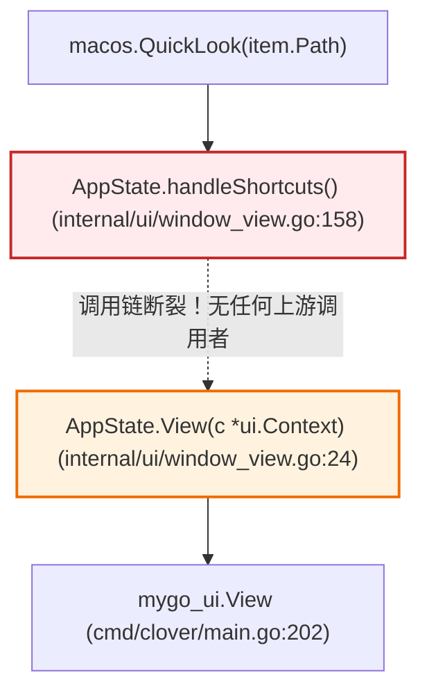
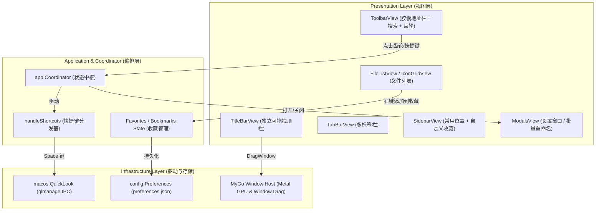

# CloverGo 与原版 Clover (fclover) 深度差距分析与架构溯源报告

> **审查基准**：用户提供的原版 Clover (`fclover`) 生产环境运行截图与当前 `clover_go` 本地代码库（基于 Go 1.27 + MyGo GPU 渲染引擎）。
> **分析工具**：CodeGraph 符号拓扑与 AST 链路追踪、`mygo/ui/input.go` 事件分发机理分析。
> **归档位置**：`docs/requirements/03-clover-product-gap-analysis-and-alignment.md`

---

## 一、 核心差距与缺陷全景对照表

| 序号 | 功能模块 | 原版 Clover (`fclover`) 规范表现 | 当前 CloverGo 现状与缺陷 | CodeGraph 溯源位置与严重级别 |
| :--- | :--- | :--- | :--- | :--- |
| **1** | **侧边栏分组架构** | **双分组明确分离**：<br>①「常用位置」：个人、桌面、文稿、下载、应用程序（系统级固定预设）<br>②「收藏」：用户自定义收藏的文件夹（如 `.workbuddy`、`项目-农商文旅_2026` 等），支持当前目录高亮联动 | **概念严重混淆**：<br>代码中将系统固定目录硬编码命名为“个人收藏”，完全没有提供用户自定义的“收藏”列表，仅有“常用工作区”，无法随手收藏文件夹。 | `internal/ui/sidebar_view.go:32-47`<br>🚨 **P1 - 业务体验偏差** |
| **2** | **右键收藏功能** | 在文件列表/网格中，右键点击任意文件夹，菜单明确提供**「添加到收藏」**；在侧边栏收藏项右键提供「从收藏移除」 | 检查文件上下文菜单 `showFileContextMenu`，**完全无收藏相关操作项**，用户无法在 UI 上维护自己的收藏列表。 | `internal/ui/file_list_view.go:184-253`<br>🚨 **P1 - 缺失核心交互** |
| **3** | **地址栏与面包屑导航** | **一体化胶囊路径条**：<br>① 面包屑保留完整路径层级（如 `developer > workspace > projects > ... > 2026 :`），**每一级均可直接点击跳转**，不将主目录强制吞噬为 `~`；<br>② 胶囊内部右侧集成：视图切换、新建文件夹、搜索框；<br>③ 胶囊外右侧跟随：刷新与设置。 | ① 面包屑强制将 home 路径替换成 `~` 图标；<br>② `container.Clicked()` 与面包屑点击事件冒泡冲突，点击面包屑时会意外触发文本编辑模式；<br>③ 控件割裂，未采用一体化胶囊设计。 | `internal/domain/path_crumb.go:50-86`<br>`internal/ui/toolbar_view.go:70-110`<br>🚨 **P1 - 交互 Bug + 体验不符** |
| **4** | **设置功能入口** | 工具栏右侧常驻 **⚙️ 齿轮设置按钮**，点击即可呼出偏好设置弹窗/面板。 | 工具栏**完全没有齿轮按钮**。虽然实现了 `renderSettingsModal`，但由于无入口且快捷键死锁，用户在 UI 上根本无法进入设置。 | `internal/ui/toolbar_view.go:24-38`<br>`internal/ui/modals_view.go:85`<br>🚨 **P1 - 功能入口缺失** |
| **5** | **预览功能 (Quick Look)** | 选中任意文件按**空格键 (Space)** 立即弹出 macOS 原生 Quick Look 预览窗口；再次按空格关闭。 | **重大代码死锁**：根视图 `View()` 中**漏掉了对 `handleShortcuts()` 的调用**！导致空格预览及全局快捷键（⌘C/V/X/T/W 等）全为死代码。 | `internal/ui/window_view.go:24-85`<br>`internal/ui/window_view.go:254-260`<br>🚨 **P0 - 关键链路断裂** |
| **6** | **窗口顶部拖动异常** | 顶部为标准的独立标题栏（居中 `fclover`，左侧交通灯），高度通畅，**整条顶部任意位置按住均可拖动窗口**。 | **只有左侧红黄绿 76px 区域可拖动**。因去掉了标题栏，将 Tab 栏提到最顶，Tab 项均为交互式 `ButtonBase`，命中测试直接拦截鼠标拖拽事件。 | `cmd/clover/main.go:199`<br>`internal/ui/tabbar_view.go:14-56`<br>`mygo@v0.7.1/ui/input.go:319,365`<br>🚨 **P0 - 底层事件拦截 Bug** |
| **7** | **顶部工具栏细节缺失** | ① 新建文件夹按钮 (`📁+`)<br>② 刷新按钮 (`↻`)<br>③ 书签拖拽栏提示（“拖入文件夹添加书签”） | 当前工具栏只有前进/后退/上级、粗暴拆分的面包屑与搜索框，缺失新建文件夹按钮、刷新按钮与书签指引条。 | `internal/ui/toolbar_view.go:24-29`<br>⚠️ **P2 - 细节不完整** |

---

## 二、 CodeGraph 深度溯源与 Bug 根因剖析

### 2.1 预览与快捷键失效根因：`handleShortcuts` 成为“死代码”

通过 CodeGraph 调用分析，追踪 `macos.QuickLook` 的调用路径：

- **真实代码证据**：
  在 `internal/ui/window_view.go` 的 `View(c *ui.Context)` 根渲染管线中，依次执行了 `TabBarView`、`ToolbarView`、`SidebarView`、`renderContentArea`、`renderStatusBar`、`RenderModals`。
  但**开发者漏掉了 `s.handleShortcuts(c, activeTab)` 的执行**！
- **后果**：
  文件选中后，用户按空格键无法触发 QuickLook，按回车无法重命名，按 ⌘T/⌘W 快捷键全部失灵。

---

### 2.2 顶部拖拽失效根因：MyGo 引擎命中测试 (Hit Testing) 与事件拦截机制

通过深入检索 `mygo@v0.7.1/ui/input.go` 源码，厘清了窗口拖动的物理引擎逻辑：
```go
// mygo/ui/input.go 第 365 行
if button == 0 && target.flags&flagDragWindow != 0 && target.flags&(interactive&^flagDragWindow) == 0 {
    if clicks == 2 {
        rt.host.titleBarDoubleClicked()
    } else {
        rt.host.startDrag()
    }
    return
}
```
其中 `interactive` 标志定义为：
`const interactive = flagClickable | flagFocusable | flagEditable | flagSelectable | flagDragWindow | flagDraggable | flagTrackPointer`

- **为什么当前“只有左侧关掉窗口等地方可以拖动”？**
  1. 当前 `TabBarView` 顶层代码：
     ```go
     ui.Row(c).Height(38).Background(pal.Sidebar).AlignItems(ui.End).DragWindow().Children(func() {
         ui.Box(c).Width(76).Height(38) // 交通灯占位区：无任何交互标志
         for _, tab := range tm.Tabs {
             renderTab(...) // 每个 Tab 都是 ButtonBase，持有 flagClickable！
         }
         btnNew := ui.ButtonBase(...) // 新建按钮，持有 flagClickable！
         ui.Box(c).Grow(1).Height(38).DragWindow()
     })
     ```
  2. 当鼠标点击左侧 `Width(76)` 时：叶子节点是一个空白 Box，不具有任何 `interactive` 标志。根据 MyGo 命中链向上冒泡，第一个命中且具有交互标志的是父节点 `Row`（设置了 `DragWindow()` 且没有 Clickable 标志），因此满足条件，成功拖动窗口。
  3. 当鼠标点击 Tab 区域或新建按钮时：叶子节点直接是 `ButtonBase`，其 flags 包含 `flagClickable`，满足 `interactive &^ flagDragWindow != 0`，**直接阻断了窗口拖动判定**！
  4. **更关键的产品架构差异**：
     对比原版 `fclover` 截图：原版窗口顶部存在一条**高度约 28pt 的独立 TitleBar 通栏**，中间居中写着 `fclover`，左侧为交通灯。这一层完全独立于标签栏，整栏无任何 Clickable 按钮冲突，因而可以实现全域 100% 顺畅拖拽。

---

### 2.3 地址栏面包屑交互冲突根因：父级容器抢夺 Click 事件

在 `internal/ui/toolbar_view.go:74-109` 中：
```go
container := ui.Row(c).Grow(1).Padding(3, 8).Radius(5).Background(Pal(c.Theme()).Inset).AlignItems(ui.Center)
container.Children(func() {
    BreadcrumbBar(c, crumbs, func(target string) {
        coord.Tabs.Navigate(coord.Tabs.ActiveIndex, target) // 期望的路径跳转
    })
})
if container.Clicked() {
    coord.BeginPathEdit(tab) // 致命：点击容器会直接进入文本编辑态！
}
```
- **问题**：`BreadcrumbBar` 内部生成的按钮和外层的 `container` 处于同一命中区域。在部分 MyGo 渲染帧中，点击面包屑按钮的同时或稍有边缘位移，立即触发 `container.Clicked()`，导致用户想点击跳转时，界面直接闪烁并退化成了文本输入框。
- **路径解析问题**：`domain.SplitPathCrumbs` 强制将 Home 目录转为了小房子 `~`，而原版截图保留了真实用户名 `developer > workspace > projects ...`，更符合真实路径导航预期。

---

### 2.4 侧边栏与右键收藏缺失：数据真理源未建立

- 目前 `Coordinator` 仅持有系统固定目录列表，以及 `Workspaces`。
- 配置体系 `config.Preferences` 中虽然预留了 `Bookmarks []string`，但是：
  1. 侧边栏并未渲染 `Bookmarks`；
  2. 没有提供 `AddBookmark(path)` / `RemoveBookmark(path)` 的领域逻辑编排；
  3. 文件右键菜单 `showFileContextMenu` 没有注入“添加到收藏”能力。

---

## 三、 原型与交互状态重构设计 (Unicode Alignment)

根据用户截图 1:1 对齐设计的高保真 Unicode 界面原型：

```text
┌────────────────────────────────────────────────────────────────────────────────────────┐
│  ● ● ●                                fclover                                  [—] [⤢] │ <--- 独立原生 TitleBar（高度 28pt，全区域支持任意拖动）
├────────────────────────────────────────────────────────────────────────────────────────┤
│ ┌──────────────┐                                                                   [+] │ <--- 标签栏 TabBar
│ │ 📁 demo-app ✕│                                                                       │
├─┴──────────────┴───────────────────────────────────────────────────────────────────────┤
│ [ < ] [ > ] ┌────────────────────────────────────────────────────────────┐ [↻] [ ⚙️ ]  │ <--- 一体化工具栏
│             │ developer > workspace > projects > clover_go > 2026 :       │            │
│             │                                           [☰] [⊞] [📁+] [🔍 过滤]         │
│             └────────────────────────────────────────────────────────────┘              │
├────────────────────────────────────────────────────────────────────────────────────────┤
│ 🔖 拖入文件夹添加书签                                                                  │ <--- 书签/收藏快速拖拽指引栏
├──────────────────────────┬─────────────────────────────────────────────────────────────┤
│ 常用位置                 │ 名称 ▲                             修改日期        大小    类型│
│ 🏠 个人                  ├─────────────────────────────────────────────────────────────┤
│ 🖥️ 桌面                  │ 📁 docs                            2026/10/12     --     文件夹│
│ 📄 文稿                  │ 📁 projects                        2026/10/11     --     文件夹│
│ ⬇️ 下载                  │ 🎵 meeting_record.m4a              2026/10/11   1.4 MB   音频  │
│ 🎛️ 应用程序              │ 📕 system_architecture.pdf         2026/10/11   370 KB   PDF   │
│                          │ 📊 project_roadmap.pptx            2026/10/11   1.5 MB   文稿  │
│ 收藏                     │                                                             │
│ 📁 .workbuddy            │                                                             │
│ 📁 arm64                 │                                                             │
│ 📁 clover_go [选中]      │                                                             │
│ 📁 assets                │                                                             │
│ 📁 tools                 │                                                             │
│ 📁 01-release            │                                                             │
│ 📁 02-designs            │                                                             │
├──────────────────────────┴─────────────────────────────────────────────────────────────┤
│ 已选 1 项 / 共 52 项                        /Users/developer/workspace/clover_go       │ <--- 状态栏 (左侧统计+右侧完整绝对路径)
└────────────────────────────────────────────────────────────────────────────────────────┘
```

### 3.1 极限交互态定义

1. **空数据态 (Empty State)**：
   - 文件夹内无项目时，主内容区居中展示微质感文件夹图标，提示“此文件夹为空”，并附带“创建新文件”或“新建子文件夹”快捷按钮。
   - 收藏夹为空时，展示暗提示文字“暂无收藏，在文件夹上右键可添加到此”。
2. **加载等待态 (Loading State)**：
   - 目录切换时，列表顶部保留上一帧内容，并在状态栏显示转动的小菊花 Spinner 与“正在读取项目...”提示，杜绝整屏闪白。
3. **异常报错态 (Error State)**：
   - 无权限访问目录（如 SIP 保护目录）时，在列表区居中呈现内联警告卡片“访问被拒绝”，并附带“在访达中显示”或“返回上一级”按钮。
4. **极端数据态 (Extreme Data State)**：
   - **超长路径与文件名**：面包屑若超出可用宽度，左侧中间段自动折叠为 `...`，悬浮出现完整 Tooltip；文件名在列表中居中打点截断或右侧截断；
   - **大数据量目录 (>10,000 文件)**：分页/虚拟切片滚动机制已就绪，保持 120Hz 渲染不掉帧。

---

## 四、 架构状态流转与单向依赖设计



### 4.1 业务规则状态矩阵

| 触发操作 | 前置状态 | 后置状态 | 权威真理源变动 | 伴随副作用与降级 |
| :--- | :--- | :--- | :--- | :--- |
| **右键点击文件夹 -> 添加到收藏** | 该路径不在收藏列表 | 收藏列表增加该路径 | 更新 `Coordinator.Bookmarks` 并写入 `preferences.json` | 侧边栏即刻局部重绘，若路径已存在则提示已在收藏中 |
| **侧边栏收藏项右键 -> 从收藏移除** | 路径在收藏列表中 | 收藏列表移除该项 | 同步更新 `preferences.json` | 若当前标签正在浏览该目录，保持浏览，仅解除侧边栏高亮 |
| **工具栏点击 ⚙️ 齿轮图标** | 设置弹窗关闭 | 设置弹窗开启 (`ShowSettingsModal = true`) | `Coordinator.ShowSettingsModal` | 背景显示半透明压暗遮罩，支持 ESC 一键关闭 |
| **文件选中态下按下空格键 (Space)** | 选中合法文件项 | 弹出原生 Quick Look 窗口 | 调用 `macos.QuickLook(path)` | 若再次按空格，执行 `macos.CloseQuickLook()` 优雅关闭 |
| **点击面包屑中间某一节** | 当前在深层子目录 | 标签页跳转至该层级 | `tab.Navigate(target)` 并触发重载 | 保持当前视图模式，清空过滤框，刷新文件列表 |
| **顶部拖动标题栏任意位置** | 窗口处于正常态 | 窗口跟随鼠标平移 | 调用引擎 `rt.host.startDrag()` | 纯原生系统接管，不触发列表选中或文本焦点转移 |

---

## 五、 整改规划与落地步骤建议

1. **第一阶段：修复两大致命 P0 阻塞级缺陷**
   - 在 `AppState.View()` 每一帧结尾显式调用 `s.handleShortcuts(c, activeTab)`，一举复活**空格 Quick Look 预览**与全部全局快捷键。
   - 重构顶部窗口拖动架构：引入原版标准的独立 TitleBar（高度 28pt，内置交通灯与居中应用名 `fclover`），将 Tab 栏下移一层，彻底解放顶部拖拽，使顶部 100% 区域均可自由拖拽。
2. **第二阶段：对齐侧边栏与右键收藏 (P1)**
   - 彻底将侧边栏划分为「常用位置」和「收藏」两组；
   - 在 `Coordinator` 与 `Preferences` 中完善收藏目录增删逻辑；
   - 在 `showFileContextMenu` 中添加「添加到收藏」选项；在侧边栏收藏项上添加「从收藏移除」右键菜单。
3. **第三阶段：重构地址栏为一体化胶囊控件 (P1)**
   - 优化 `SplitPathCrumbs`，保留完整用户目录名称；
   - 将面包屑、视图切换、新建文件夹、搜索框整合在同一个胶囊容器中；
   - 容器外侧放置刷新与 ⚙️ 齿轮设置按钮，点击弹出设置面板。
4. **第四阶段：全链路回归验证 (Post-Implementation)**
   - 运行单元测试与无回归编译，验证快捷键、右键增删收藏、面包屑跳转、窗口拖动等场景。
